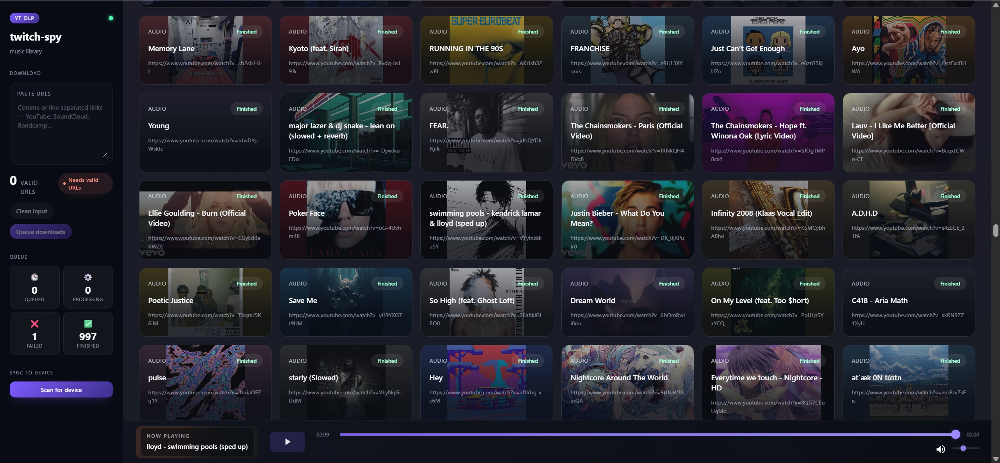

# twitch-spy

A self-hosted music library manager. Paste YouTube URLs — individual videos, playlists, or channels — and the system
downloads, tags, and organizes them into a local audio library with a real-time web UI.

---

## Features

- **Bulk URL ingestion** — accepts single videos, playlists, channels, and mixed input (newline or comma separated).
  JSON arrays are also parsed automatically.
- **Atomization** — any input is broken down into the smallest downloadable unit (individual tracks) before processing.
  Playlists expand into per-track jobs automatically.
- **Parallel downloads** — jobs run concurrently via a thread pool, maximizing throughput on network-bound workloads.
- **Deduplication** — URLs are normalized (e.g. `music.youtube.com` → `www.youtube.com`) and checked against the local
  archive before queuing, so re-submitting the same tracks is safe.
- **Metadata & thumbnails** — each track gets its title and cover art embedded via yt-dlp and ffmpeg.
- **Real-time UI** — a React frontend receives live job status updates over Socket.IO. The library grid, queue counters,
  and now-playing dock all update without polling.
- **Android sync** — one-way library sync to an Android device over ADB. The UI computes a sync plan (new files,
  directories to create, bytes to transfer) before executing, with per-file progress reporting.
- **Audio player** — built-in browser player with album-art-derived ambient color, progress bar, and volume control.

---

## Preview



---

## Stack

| Layer              | Technology                                        |
|--------------------|---------------------------------------------------|
| Backend            | Python · Flask · Flask-SocketIO · yt-dlp · ffmpeg |
| Frontend           | React · TypeScript · Vite · Socket.IO client      |
| Package management | uv (Python) · npm (frontend)                      |
| Android sync       | adb (WSL-compatible)                              |

---

## Prerequisites

- Python 3.11+
- Node.js 22+ (also used to solve YouTube JavaScript challenges)
- [uv](https://github.com/astral-sh/uv)
- ffmpeg

Prebuilt desktop releases do not require Python, Node.js, FFmpeg, or ADB to be installed.

```bash
# Install ffmpeg (Debian/Ubuntu/WSL)
make install-ffmpeg
```

---

## Installation

```bash
# Install Python dependencies
make install

# Install frontend dependencies
cd client && npm install
```

---

## Running

Start the API server and the frontend dev server in two separate terminals:

```bash
# Terminal 1 — backend (Flask + Socket.IO)
make run_api

# Terminal 2 — frontend (Vite dev server)
make run_web
```

Then open [http://localhost:5173](http://localhost:5173) in your browser.

`make run_api` fixes the development backend at `127.0.0.1:5000`, which is where the Vite proxy sends API and Socket.IO traffic. It also passes `--no-browser` and `--dev`, because Vite owns the development UI at port 5173 and needs its origin enabled for Socket.IO. Packaged desktop builds still select an available port and open the browser automatically.

The `--output-dir` flag (set in the Makefile) controls where the development library and logs are written. It is `./data` for `make run_api`.

### Desktop releases

Every push to `main` automatically builds and publishes native x86_64 artifacts for Windows and Linux after verification succeeds:

- `twitch-spy-vX.Y.Z-windows-x64.exe`
- `twitch-spy-vX.Y.Z-linux-x86_64.AppImage`

CI calculates the next patch version from numeric `vX.Y.Z` tags and GitHub release
reservations. For example, `v0.1.641` becomes `v0.1.642`; you do not edit a version
or create a tag. A push containing multiple commits builds its final commit.
Configuration and dependency changes trigger the same workflow.

The version job reserves a draft release for the exact source commit and passes
its version to all build jobs. Each job stamps `pyproject.toml` and the root package
entry in `uv.lock` in its disposable checkout before installing dependencies.
The installed package metadata, health endpoint, diagnostics, and artifact names
therefore use the same version. No version-bump commit is pushed back to `main`.
The checked-in version is the initial version seed when no release tags or
reservations exist. Local desktop builds derive their version from Git automatically.

Release runs are serialized, with up to 100 pending runs queued by GitHub Actions.
Failed runs retain their draft reservation; rerun the failed workflow to retry the
same version. Later pushes receive higher versions, so gaps are possible. Do not
delete draft reservations if you intend to retry them. Published releases are
skipped on retries and their assets are never overwritten. Retrying an older draft
does not replace a newer release as **Latest**. Tags are created when the verified
draft is published, and point to the source commit shown in its release notes.

To inspect the next patch number locally without changing files:

```bash
git fetch --tags origin
make next-version
# Optional previews for larger increments (no files or releases are changed):
make next-version BUMP=minor
make next-version BUMP=major
make release-help
# Windows, or without Make:
uv run python scripts/release.py next-version
```

This preview uses local tags only; CI also sees unpublished draft reservations.
In GitHub, open **Actions → Desktop release** to inspect the calculated version
and build jobs. **Run workflow** on `main` offers patch/minor/major increments;
an already reserved or published commit keeps its version. To select a minor or
major increment for a new commit, skip its automatic push run with `[skip ci]` in
the commit message, then manually run the workflow on `main` with the desired bump.
Normal commits need no special message. The workflow uses the built-in
`GITHUB_TOKEN` with `contents: write` for reservation and publication; no personal
token is needed. Repository or organization rules must allow this workflow to
create release tags.

The desktop application opens its local UI in the default browser and stores persistent data in `%LOCALAPPDATA%\TwitchSpy` on Windows or `$XDG_DATA_HOME/twitch-spy` on Linux (defaulting to `~/.local/share/twitch-spy`). Use the UI's **Quit application** button to stop the local server.

Windows builds show a startup window while the single-file executable unpacks and the server starts. It displays an animated activity bar, elapsed time, and a rolling stream of extraction and application messages, then closes when the browser is launched. It does not stay above other applications. Startup duration after Python loads is recorded in `logs/application.log`; this excludes executable extraction. For unattended launches, set `PYINSTALLER_SUPPRESS_SPLASH_SCREEN=1` before starting the executable. `--no-browser` and `--check-tools` close the splash once Python starts.

Saved tracks load in the background after the server starts. The library shows loading progress and makes tracks available in batches, while downloads and other controls remain usable. Each folder is indexed once, and artwork is read only when requested. Library restoration time is recorded separately in `logs/application.log`; any scan failure is shown in the UI without removing tracks already loaded.

Windows executables also show a tray icon with **Open Twitch Spy**, **Health and resource usage**, **Open logs folder**, and **Quit Twitch Spy**. While the tray is active, closing the browser leaves the backend running. Quit stops the server, cancels queued downloads, and waits for active downloads and Android sync to finish. Windows may place the icon in the taskbar's hidden-icons menu.

The tray is optional for native Windows CLI/development runs:

```powershell
uv run twitch-spy --dev --port 5000 --output-dir ./data --no-browser --tray
```

Start Vite separately as usual; development tray links open `http://localhost:5173`. Source/CLI runs default to no tray. Use `--no-tray` to disable it in the executable, including headless or service sessions. `--no-browser` only suppresses automatic browser launch. Linux/WSL runs do not create a Windows tray icon. If tray initialization fails, the app logs the error and retains its existing browser-controlled lifecycle.

Select **Health and logs** in the UI (or the tray's health action) for backend status, uptime, download/sync activity, CPU, working-set/RSS memory, threads, live child processes, and recent application logs. Metrics refresh every two seconds only while the panel is open and the tab is visible; Pause freezes the view. CPU uses 100% per logical core and needs two samples. Values cover the backend and its live descendants, not whole-system usage, the browser, or the separate Vite server. Shared memory may be counted more than once; short-lived subprocesses can fall between samples. The panel reports backend reachability and activity, not whether an individual download is making progress.

Logs are stored in `<output-dir>/logs/application.log`, rotating at 5 MiB with three backups. The UI reads at most 64 KiB / 200 recent lines. The tray's logs action opens the full log directory. CLI users can inspect these same files (for example, `Get-Content ./data/logs/application.log -Tail 100 -Wait`).

Useful runtime overrides are `--output-dir`, `--port`, `--no-browser`, `--tray` / `--no-tray`, `--adb-exe`, and `--ffmpeg-location`.

Python installs and desktop builds include yt-dlp's recommended dependencies, including
`curl_cffi` for browser impersonation and `yt_dlp_ejs` for YouTube challenge scripts.
Executing those scripts also requires [Deno](https://docs.deno.com/runtime/getting_started/installation/)
on the user's `PATH`; the desktop build does not bundle a JavaScript runtime.
See [yt-dlp's EJS setup guide](https://github.com/yt-dlp/yt-dlp/wiki/EJS).

Run `make build` to build locally; no version editing or stamping is needed.
The build refreshes tags from `origin` and chooses the version automatically:

| Source state | Example build version |
| --- | --- |
| Clean checkout at release tag `v0.1.641` | `0.1.641` |
| Two commits after that tag | `0.1.642.dev2+g123456abcdef` |
| Uncommitted changes | `0.1.642.dev2+g123456abcdef.dirty` |
| CI release candidate | The version reserved by CI |

Local builds stamp a temporary copy of the source, leaving your tracked files
unchanged, and put the finished artifact in `dist/`. `make smoke` and
`make checksums` automatically select the latest successful build for each platform,
even if you edit the source afterwards. A clean checkout of a published release
builds with the same version as CI; unpublished commits use development versions
and do not allocate official release numbers.

If fetching tags fails, the build warns and uses local tags. Use
`uv run python scripts/build.py build --no-fetch` to skip that fetch explicitly;
dependency installation and build-tool downloads may still require network access.
Local builds require a Git checkout. Source archives without Git metadata should
be built through the CI workflow or replaced with a clone.

Available build commands:

```bash
# Build for the current native platform (WSL defaults to Linux)
make build

# Linux or WSL: produce the Linux AppImage
make build-linux

# Explicit WSL alias
make build-wsl

# From WSL: stage and run the build using native Windows Python
make build-windows

# Build both artifacts sequentially
make build-all

# Run tests, frontend lint, and frontend build
make verify

# Smoke-test an existing Linux AppImage
make smoke-linux

# Smoke-test whichever desktop artifacts currently exist
make smoke

# Generate .sha256 files
make checksums

# Show generated artifacts
make artifacts
```

All build logic is implemented by one Python command. Make targets are convenience aliases:

```bash
uv run python scripts/build.py build --target linux
uv run python scripts/build.py build --target windows
uv run python scripts/build.py build --target all
uv run python scripts/build.py verify
uv run python scripts/build.py smoke --target all
uv run python scripts/build.py checksums --target all
```

On native Windows, run the same `scripts/build.py` command from a Windows terminal. From WSL, a Windows target is copied to a temporary Windows-side staging directory and executed with `py.exe -3.13`; the finished EXE is copied back to `dist/`. Use `--keep-staging` to retain that directory for diagnostics.

Build prerequisites are Python 3.13, uv, and Node.js/npm on the native target platform. The orchestrator installs project dependencies and downloads platform-tools/appimagetool, but it does not install Python, uv, or Node. PyInstaller still runs natively, so a normal Linux host cannot produce the Windows executable and Windows cannot produce the Linux AppImage.

Manual browser verification scripts live in `tests/` and belong in version control.
They are separate from the automated pytest suite and CI smoke tests:

```bash
make check-preview     # Latest Windows executable: tray and diagnostics UI
make check-components  # Responsive sidebar and sync dialog; requires Vite on port 5173
make check-library     # Library UI; requires Vite on port 5173
```

These checks use headless Microsoft Edge and install the Playwright Python package
through `uv run --with playwright`; Edge must already be installed. Without Make,
run `uv run --with playwright python -m tests.check_preview` (or the corresponding
`tests.check_components` / `tests.check_library_browser` module). Screenshots are
generated under `dist/`, which remains ignored and safe to remove with
`make clean-build`. Executable build logic lives in `scripts/`, never in `dist/`.

Windows binaries are initially unsigned and may trigger SmartScreen. Android devices can still require manufacturer USB drivers on Windows or udev rules and USB permissions on Linux.

Additional startup checks and developer utilities are also version-controlled:

```bash
uv run python -m tests.check_library_packaged  # Latest Windows build, temporary 1,600-track library
uv run python -m tests.check_splash            # Latest Windows build; opens a browser tab
uv run python scripts/preview_startup.py       # Windows splash preview and screenshot
uv run python scripts/benchmark_library_startup.py --baseline HEAD --tracks 1600
```

The benchmark compares the working tree with the specified Git revision. After committing an optimization, select a revision from before that change with `--baseline`. The packaged checks use `dist/latest-windows.json`; build a Windows executable first. Generated screenshots, logs, and executables stay under the ignored `dist/` directory.

---

## Usage

1. Paste one or more YouTube URLs into the input box — single videos, playlists, channels, or a mix.
2. Click **Queue downloads**. The backend atomizes the input and enqueues individual track jobs.
3. Watch the queue counters and library grid update in real time as tracks finish downloading.
4. Click any card in the library to play it in the browser.
5. Use the **Sync to device** panel to push new tracks to a connected Android device over ADB.

## Useful scripts

Extract all individual links from a music.youtube.com private (not publically accessible) playlist:

1. Open the playlist in a popular browser (chrome, firefox, e.t.c)
2. Open console (F12)
3. Execute this script in console. It will copy all the links to your clipboard as a JSON array.

```javascript
copy(
    [...document.querySelectorAll('ytmusic-responsive-list-item-renderer')]
        .map(el => el.querySelector('yt-formatted-string a')?.href)
        .filter(Boolean)
        .map(u => u.split('&')[0])
)
```

4. Paste the JSON array with the links in this application and bulk download all the resources.
